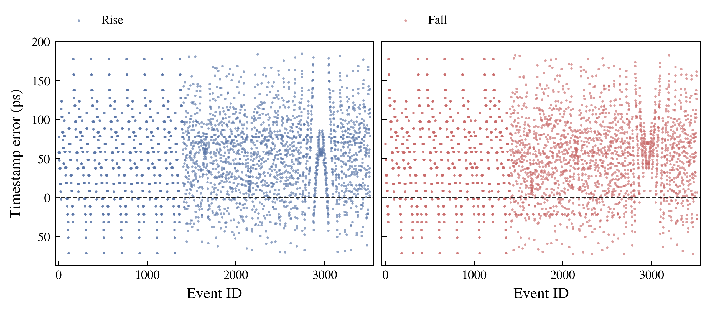
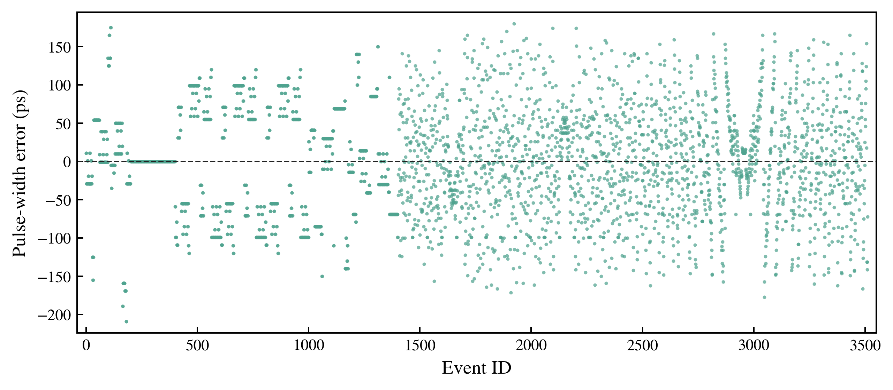
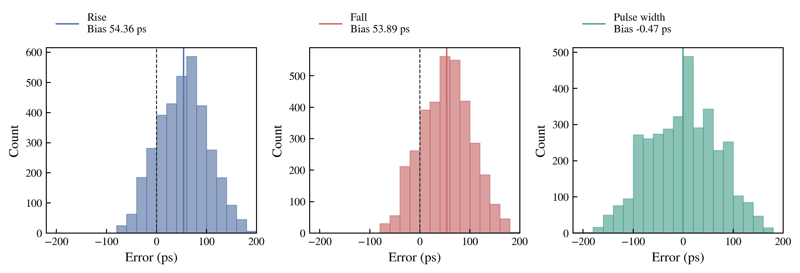

# 05轮冻结实现的完整MAX-SDF验收

**功能与精度数据验收：PASS。原始Timing Check总项：FAIL；核心同步逻辑复位后Timing Check：PASS。没有将功能通过等同于全局静态时序或CDC签核。**

实际使用XSim2022.2、Slow/MAX、1ps分辨率，完整运行3512个原PWM脉冲及7024个边沿。3512/3512正确测量，丢沿、重复沿、错配、无效输出、FIFO溢出及序列错误均为0。六个历史事件2917/2918/2983/2984/3049/3050的rise/fall/width各出现一次。

## 分项验收

| 项目 | 结论 |
|---|---|
| SDF_generation | **PASS** |
| SDF_annotation_coverage | **PASS** |
| real_gate_models | **PASS** |
| edge_capture | **PASS** |
| pulse_width | **PASS** |
| FIFO_integrity | **PASS** |
| reset_behavior_initial_sequence | **PASS** |
| precision_statistics | **PASS** |
| Timing_Check_raw | **FAIL** |

精度统计PASS仅表示全样本、真值、误差及图表完整，用户未给定数值精度阈值，本报告没有自行发明RMS门限。
复位PASS限于原冻结复位流程和本次初始释放，未扩展成任意运行中复位或失锁重锁保证。

## 唯一实现来源与冻结证明

源Commit：`ba978229094a8621b30770177727d8e70b831a74`。唯一DCP为05任务`results/compensated/design.dcp`。
DCP SHA256：`d4d983986e7b84bf06fc786f91c258d58cabc110e6e4b87c09e0ae6268cbbb52`。
仅用Vivado2022.2打开该DCP，原样导出`netlist/post_route_max.sdf`和`post_route_timing.v`；无综合、布局布线、write_checkpoint或BIT生成。
源DCP/网表/RTL/有效XDC/时序报告/原3512激励/原8参数与05提交逐项核对，结束后再次核对内容哈希全部不变，4个IP XCI也与05哈希一致。
SDF头为Vivado2022.2、tdc_meas_top、1ps、SDF3.0，生成于2026-11-05 22:17:53北京时间；器件来自DCP为xc7k325tffg900-2。
`write_sdf -process_corner slow`默认timesim；`write_verilog -mode timesim -sdf_anno false`。实际工具命令帮助及完整导出日志保留。

## 环境与注释检查

ModelSim SE-64 2020.4能够启动、编译并加载原厂FDCE，环境SDF探针实测MAX路径300ps，故意Setup违例也被报告，许可和基本SDF能力可用。历史Xilinx库映射目录失效，已从Vivado2022.2原厂源码补编DCP实际所用26类原语，共9408个叶单元；FIFO/ILA的真实加密实现模型由网表携带，无自写CARRY4/FIFO/MMCM行为替代。
ModelSim实际网表已编译，但初次及后续保持层级/条件负检查求解的0时刻注释尝试仍出现5184条互连不相连警告，包含核心28个有效fine-code输入；并有负检查限制自动归零，以及12123旧PLI兼容性提示。未将这些尝试作为正式功能数据，全部失败日志保留。
原版2020.4手册981页说明level3为按条件求解，level0会忽略负检查；本轮没有使用level0、no_neg_tchk或关闭检查的选项。一次legacy加载仅处理12110性能/弃用提示，未屏蔽任何SDF或timing消息，该尝试同样未被接受。
ModelSim所显示68.94%路径、36.10%检查是完整原语specify对象分母；SDF指定35015项检查实际均被其接收。因此不能仅凭百分比判失败；真正未接受的原因是互连/负检查问题，而非许可或TDC RTL功能失败。

随后使用Vivado配套XSim2022.2及其真实simprims_ver/secureip库，对完全相同的网表/SDF严格注释。xvlog/xelab明确报告`SDF backannotation was successful`，没有缺失实例、端口、IOPATH、互连或检查项诊断，未使用忽略错误/告警的选项。
只用xelab外部`--sdfmax /tb_tdc/dut=...`一次注释；网表内部`sdf_annotate`数为0，TB的备用注释宏未启用。

SDF请求精确计数：8828个实例（包含根）、25083条IOPATH、30001条INTERCONNECT、30832项SETUPHOLD、2204项WIDTH、1146项PERIOD、833项RECREM，总计35015个检查。
这些数量与严格全局注释成功及零未匹配诊断交叉验证；XSim不直接给逐条成功计数，所以SDF_COVERAGE.json明确标注接受数量为“依据严格诊断推定”，没有冒称逐条参数读回。
运行中另观察4相rise/fall辅助D路径为2775/2964/3053/3149ps，8组均非零且对应真实SDF传播，见RUNTIME_SDF_PATH_DELAYS.csv；该观察不作为新补偿拟合。
26类原厂模型含真实CARRY4、RAMB36E1、MMCME2_ADV；TDC的64个CARRY4结构来自05冻结DCP。没有用理想RTL仿真代替本次门级验证。

## 数据完整性、复位与FIFO

输入全3512脉冲/7024边沿、原始频率/占空比/相位/扰动/真值及绝对边沿时间未改，仍在MMCM锁定及复位释放后开始输入。未插入等待来移动激励；通过实际复位释放时间远早于固定首边沿证明原预热窗口充足。
原末级在675164ps、副本在675183ps释放，两者均为第106个本地时钟周期，物理差19ps，无额外释放拍数。MMCM_locked均为1；首输入10000010ps，首脉冲ID0真值25300ps、测量25311ps，误差+11ps。
FIFO写请求、读请求、实际valid输出均为3512，结果序列与测量脉宽完全相同，error FIFO及overflow均为0。
FIFO_READS.csv是读请求当拍的旧dout/valid观察；Standard FIFO正式读出数据对比使用后续valid对齐的fifo.csv，未把读请求误当读valid。
候选与时间戳按发射时刻10ns流水关系连接，width与fall timestamp按6ns关系连接；真值按冻结的独立候选延迟、事件ID和极性匹配，未简单按数组下标配对。
最小事件关联余量3310ps，最大关联残差387ps。无未匹配、歧义或非法码；所有异常记录字段为空而非被删除。

## 精度统计（单位ps）

| 测量 | N | Bias | RMS | STD | MaxAbs | Min | Max |
|---|---:|---:|---:|---:|---:|---:|---:|
| Rise | 3512 | 54.361 | 73.487 | 49.449 | 185 | -71 | 185 |
| Fall | 3512 | 53.886 | 73.197 | 49.539 | 183 | -72 | 183 |
| Pulse width | 3512 | -0.475 | 70.470 | 70.468 | 209 | -209 | 180 |

RMS=√mean(error²)，STD=√mean((error−Bias)²)，使用总体标准差。timestamp先按实际clock epoch及冻结发射关系确定模2048000ps的周次，再算绝对测量时间−输入真值；没有减去验证集均值、没有重拟合偏移、没有剔除离群样本。
Rise/Fall均约+54ps的公共偏差在脉宽相减时大部分抵消，脉宽Bias接近0并不表示绝对时间戳无偏。全样本最大绝对时间戳误差185/183ps，最大绝对脉宽误差209ps。
误差图保留每个原始点，不平滑、不裁剪。SVG矢量和360dpi PNG均已目检，原始绘图数据即EDGE_RESULTS.csv、PULSE_RESULTS.csv，直方图bin/count另存ERROR_HISTOGRAM_DATA.csv。

### 各测试组

| 原测试组 | N | Width RMS ps | Bias ps | MaxAbs ps |
|---|---:|---:|---:|---:|
| fixed_25300 | 200 | 74.036 | 0.000 | 209 |
| 10MHz_50 | 200 | 0.000 | 0.000 | 0 |
| 20MHz_50 | 200 | 81.020 | 0.000 | 120 |
| 10MHz_5 | 200 | 81.020 | 0.000 | 120 |
| 10MHz_95 | 200 | 81.020 | 0.000 | 120 |
| 20MHz_5 | 200 | 65.351 | 0.000 | 150 |
| 20MHz_95 | 200 | 65.351 | 0.000 | 150 |
| ATC_10MHz | 1056 | 71.666 | -2.429 | 180 |
| ATC_20MHz | 1056 | 70.669 | 0.849 | 177 |

10MHz/50%这一200样本子组的0ps误差来自相同采样相位/量化误差在rise/fall相减时抵消，不代表无限精度或所有10MHz波形都无误差。ATC_10MHz和ATC_20MHz分别有1056个完整样本。频率切换邻域、帧头及SPWM数据分组均保存，无丢失ID。

## 四相补偿效果

8参数保持0°36081、90°36011、180°35742、270°35756ps，rise/fall分别独立选择（本组数值相等），sel_index=3/0/1/2，不重新校准。
按实际选中的同批SDF样本，加回原参数仅作未补偿算术重建，脉宽RMS从161.614降为70.470ps，降低56.40%。它与历史03辅助Baseline的前端raw/candidate/taps逐字节相同，但不把算术重建冒称另一次Baseline实现。

| 相位/极性 | N | 原offset ps | 未补偿相对TDL0偏差 ps | 补偿后相对TDL0偏差 ps |
|---|---:|---:|---:|---:|
| 0° rise | 834 | 36081 | +0.000 | +0.000 |
| 90° rise | 1024 | 36011 | -54.095 | +15.905 |
| 180° rise | 1110 | 35742 | -275.520 | +63.480 |
| 270° rise | 544 | 35756 | -262.543 | +62.457 |
| 0° fall | 956 | 36081 | +0.000 | +0.000 |
| 90° fall | 894 | 36011 | -58.072 | +11.928 |
| 180° fall | 1042 | 35742 | -278.404 | +60.596 |
| 270° fall | 620 | 35756 | -266.704 | +58.296 |

最大残余相对偏差约63.48ps，固定相间偏差得到改善但没有完全消失。每相统计来自其实际选中事件群体，样本分布不同，不是所有TDL同时测同一事件的成对校准。本报告不将这些均值写回参数。

## 与历史版本比较

| 版本/条件 | 正确脉冲N | Width RMS ps | Bias ps | 条件说明 |
|---|---:|---:|---:|---|
| 03_aux_baseline_RTL | 3512 | 3.205 | 0.072 | ideal RTL; 10ps/tap model; no routed input delay |
| 04_merged_compensated_RTL | 3512 | 190.856 | -8.266 | ideal RTL with fixed physical-calibration offsets |
| 05_optimized_compensated_RTL | 3512 | 190.856 | -8.266 | ideal RTL with same fixed physical-calibration offsets |
| original_baseline_RTL_archive | 3512 | 3.205 | 0.072 | historical original RTL archive; different original frontend/pipeline |
| 01_compensated_SDF_historical | 3506 | 68.837 | -1.045 | historical MAX-SDF; same 8 offsets; six original failed pulse IDs retained |
| 03_aux_baseline_SDF | 3512 | 161.614 | 1.647 | historical MAX-SDF; auxiliary four-phase; compensation bypass |
| 05_compensated_MAX_SDF | 3512 | 70.470 | -0.475 | current full MAX-SDF from 05 frozen final DCP; XSim 2022.2 |

04和05的理想RTL结果逐事件完全相同，证明优化未改原算术；04未跑MAX-SDF，不能虚构04时序精度。理想RTL的均匀10ps/tap、无布线路径与物理SDF条件不同，物理校准参数直接用于理想模型会产生失配，190.856→70.470不能宣称为算法提升。
理想Baseline的3.205ps也不是硬件精度；加入真实延迟的旁路对应161.614ps，原参数补偿后70.470ps。原始RTL的公共流水线未校准约32ns，补偿RTL在理想模型下绝对timestamp约−3.9ns，不与真实SDF的73ps RMS混为同条件性能。
在与历史01补偿SDF相同3506个ID上，本次RMS 70.491ps，旧版68.837ps，变化+2.40%；本次另外恢复原6个失败ID。没有将略增的RMS隐藏成改善；两版物理实现/辅助通路不同，不能将差异全部归因于05的Locate优化。
逐事件数据见VERSION_COMPARISON.csv、EVENT_VERSION_COMPARISON.csv和SAME_SDF_COMPENSATION_EFFECT.csv。

## 全部Timing Check与CDC

原始日志共1160650条timing violation，无关闭/过滤检查，完整记录逐条CSV和原日志。核心同步逻辑在复位释放后告警为0；原始总项因下列告警仍为FAIL。

| 类别 | 原检查名 | 总数 | 复位释放后 |
|---|---|---:|---:|
| AUX_first_stage_asynchronous_sampling | setuphold | 1312 | 1312 |
| ILA_PWM_asynchronous_debug | setuphold | 177 | 177 |
| TDL_asynchronous_sampling | setuphold | 85416 | 85416 |
| reset_synchronizer | recrem | 1 | 0 |
| unused_MMCM_CLKOUT5_6_model | period | 1073744 | 1072898 |

SETUPHOLD和RECREM是仿真器联合检查类型，未虚构拆分Setup/Hold或Recovery/Removal次数。没有额外Width告警；MMCM未使用CLKOUT5/6的Period日志限值为0，属于需保留的模型/仿真器告警，不认作已消除。该两输出不连接测量链路，但未在本轮彻底解释工具内部原因。
TDL及辅助首级本来直接异步采样PWM，告警必须与主同步路径区分；本次全量功能通过不能代替亚稳态/MTBF、PVT或硬件可靠性证明。1条复位联合Recovery/Removal发生在初始预热期、释放前，仍完整保留。
05静态WNS/TNS=-0.050/-0.166ns、WHS/THS=+0.054/0，14条ILA2 Setup未收敛仍存在，不能把本次链路功能PASS等同全局时序收敛。

两条CDC-11在03、04、05报告中相同，起点rst_sync_500m_reg[1]，终点两个FIFO内部100MHz域的5级XPM复位同步链首级。实际DCP核查20个相关FDRE（每FIFO的100/500MHz各5级）均ASYNC_REG=1、INIT=1，原源还扇出至本地/BRAM控制。05新增副本只优化写门控，未改FIFO rst端口，所以不是05新引入的CDC结构。
本次复位释放、首脉冲、busy门控及全部FIFO序列通过；但没有运行中复位、MMCM失锁/重锁或任意相位扫描，不能未经分析将CDC-11直接认定无害或宣布已关闭。CDC_RESET_STRUCTURE/FANOUT.csv和CDC_FROZEN_RECHECK.rpt保留真实结构。

## 是否进入BIT及上板

功能与精度链路具备继续实验的数据基础；**尚不能将本报告作为无条件可上板验收**：Timing Check总项未PASS，两条CDC-11未签核，原14条ILA2静态违例未收敛。下一轮应明确处置/接受这些已列明问题，并补足所需复位/可靠性验证。本轮没有生成BIT或修改设计来取得PASS。

## 文件、复现与Git

原始EDGE/PULSE结果、全部时序告警、失败ModelSim记录、SDF/网表、命令、CSV和图表均保留。大型原日志及TIMING_VIOLATIONS.csv在本地保留原件，Git归档使用无损gzip，解压SHA256与原件核对；LOG_COMPRESSION_MANIFEST.json说明大小和映射，未静默遗漏证据。
分支`codex/2026-11-05-06-tdc-max-sdf-validation`，基于指定ba978提交，提交说明`2026-11-05-06-四相TDC-MAX-SDF验证`。04/05归档不覆盖，不合并main、不强推；实际提交及推送状态见执行结束报告。
复现要求Vivado/XSim2022.2、唯一05 DCP及冻结激励，所有输出写独立副本：freeze_inputs.py→export_sdf.tcl→prepare_simulation.py→run_xsim.py prepare/compile/annotate→check_sdf_coverage.py→run_xsim.py full→analyze_results.py/analyze_timing.py/compare_versions.py。禁止覆盖此处已完成结果；正式RTL从未修改。
文件清单与内容校验见FILE_LIST.md、SHA256SUMS.txt。
